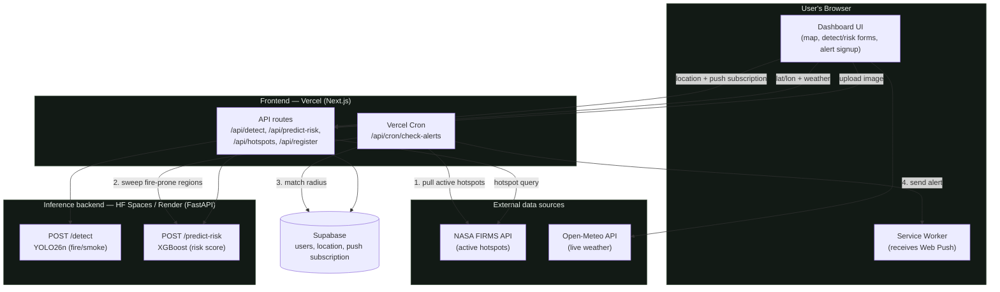
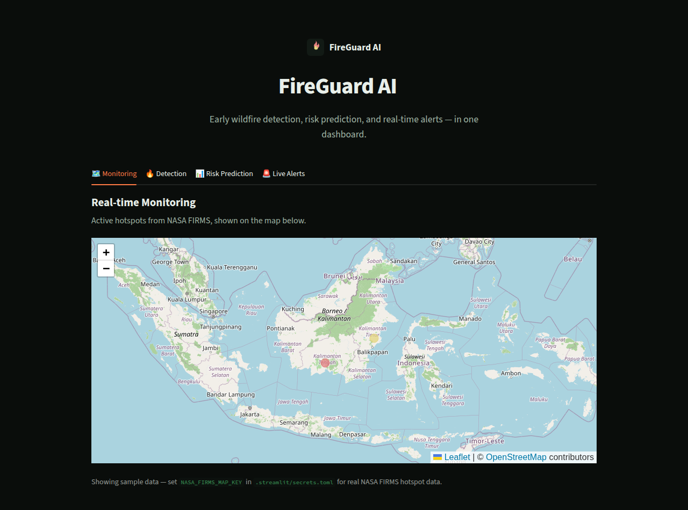

# FireGuard AI

> **Neural Storm 2026 — Green Planet track** (Sustainability & Environmental
> Intelligence). Self-defined problem statement within the track, as
> permitted by the competition rules.

AI dashboard for early wildfire detection, risk prediction, and real-time
alerts, complete with automatic notifications for residents within range of
a dangerous area.

## Team
**Tim FireGuard**
- Mus

## Table of Contents
- [Problem & Solution](#problem--solution)
- [Architecture](#architecture)
- [Tech Stack](#tech-stack)
- [Repo Structure](#repo-structure)
- [Setup & Installation](#setup--installation)
- [Running the Project Locally](#running-the-project-locally)
- [Datasets](#datasets)
- [Model Performance](#model-performance)
- [Screenshot / Demo](#screenshot--demo)
- [Deployment](#deployment)
- [AI Tools Disclosure](#ai-tools-disclosure)
- [License](#license)

## Problem & Solution
Wildfires are hard to detect early and predict, so mitigation response is
often too late. FireGuard AI combines four capabilities into one dashboard:

1. **Early detection** — upload an image, a YOLO26 model (ready-made checkpoint, see [Model Performance](#model-performance)) detects smoke/fire with a confidence score.
2. **Risk prediction** — pick a location, pull live weather, and get a fire-risk score (Low/Medium/High) from a trained XGBoost model.
3. **Real-time monitoring** — a map of active hotspots from NASA FIRMS.
4. **Automatic alerts** — a scheduled job combines fresh NASA FIRMS hotspots
   with automated risk-prediction sweeps across known fire-prone regions
   (Kalimantan, Sumatra), then sends a Web Push Notification to any
   registered user within a 10km radius — no manual lookup required for
   either signal.

The on-screen risk prediction and detection forms are for an on-demand,
single-location check; the actual prevention value comes from the
background cron job (`frontend/app/api/cron/check-alerts/`) that runs both
signals automatically on a schedule. See [`ide.md`](./ide.md) for the full
architecture & planning notes.

## Architecture



The frontend never talks to the inference backend or Supabase directly from
the browser — everything routes through Next.js API routes, so secrets
(`BACKEND_INFERENCE_URL`, Supabase service key, VAPID private key) stay
server-side. The cron job is the automated prevention loop: it is what
turns "the user can check one point manually" into "the system watches
fire-prone regions on its own and pushes a warning before anyone has to
ask" — see [Problem & Solution](#problem--solution) for why that
distinction matters.

## Tech Stack
- **Frontend**: Next.js, React, Leaflet — deployed on Vercel
- **Backend inference**: FastAPI, YOLO26 (Ultralytics), scikit-learn/XGBoost
  — deployed on HuggingFace Spaces / Render
- **Database**: Supabase (Postgres)
- **Notifications**: Web Push (VAPID)
- **Data sources**: NASA FIRMS API, Open-Meteo API

## Repo Structure
```
frontend/   Next.js app (dashboard, API routes, cron alert)
backend/    FastAPI app (detection & risk prediction models)
Info.md     Official Neural Storm 2026 competition brief
ide.md      Project idea & planning notes
LICENSE     MIT license
```

## Setup & Installation

### Backend (FastAPI)
```bash
cd backend
python3 -m venv venv
source venv/bin/activate
pip install -r requirements.txt
uvicorn main:app --reload
```
Set up the models in `backend/models/` (see the Model Performance section
below for sources & how to get them):
- `wildfire-smoke.pt` (YOLO26n, ready-made checkpoint from HuggingFace — see
  `backend/ml/detect/README.md` for how to download it & further fine-tuning options)
- `risk_model.joblib` (XGBoost, trained in-house; a rule-based fallback is
  used automatically if this file isn't present yet)

### Frontend (Next.js)
```bash
cd frontend
npm install
cp .env.example .env.local   # fill in at least BACKEND_INFERENCE_URL first
npm run dev
```
Module 1 (map) & 3 (risk prediction) already work with no extra credentials.
Module 4 (alert signup) needs Supabase + VAPID keys filled in `.env.local`
first — see the comments in `frontend/.env.example`.

## Running the Project Locally
Already verified end-to-end (frontend → API route proxy → FastAPI backend
→ real model) during development:
1. Start the backend: `cd backend && source venv/bin/activate && uvicorn main:app --reload` (default `http://localhost:8000`).
2. Set `BACKEND_INFERENCE_URL=http://localhost:8000` in `frontend/.env.local`.
3. Start the frontend: `cd frontend && npm run dev` (`http://localhost:3000`).
4. Open `http://localhost:3000` — the risk prediction form & map are already
   live; the image detection form needs `backend/models/wildfire-smoke.pt`
   to exist first (see Model Performance below).

Frontend API route structure (all under `frontend/app/api/`):
- `predict-risk/` — proxies to `BACKEND_INFERENCE_URL/predict-risk`
- `detect/` — proxies to `BACKEND_INFERENCE_URL/detect` (image upload)
- `hotspots/` — proxies to NASA FIRMS (falls back to sample data if
  `NASA_FIRMS_MAP_KEY` isn't set)
- `register/` — saves a user's location + push subscription to Supabase
- `cron/check-alerts/` — called by Vercel Cron; pulls danger points from
  NASA FIRMS + automated risk prediction over `lib/monitored-locations.ts`
  (fire-prone regions across Kalimantan & Sumatra), checks radius against
  registered users, sends Web Push

## Datasets
| Module | Dataset | Size | Source |
|---|---|---|---|
| Risk prediction | UCI Algerian Forest Fires Dataset | 244 observations, 2 regions | [UCI #547](https://archive.ics.uci.edu/dataset/547/algerian+forest+fires+dataset) |
| Early detection | FASDD_CV | 95,126 images, YOLO format | [HuggingFace seawsurf/fire_smoke_dataset_fasdd_cv](https://huggingface.co/datasets/seawsurf/fire_smoke_dataset_fasdd_cv) |

The FASDD_CV dataset was downloaded & fully verified in this repo (see
`backend/ml/detect/README.md`). For the detection model itself, we use a
ready-made checkpoint already trained on the same dataset (not trained from
scratch) — the development laptop has no GPU, and this checkpoint already
reaches good accuracy. See the Model Performance section for full details +
citation; the in-house training pipeline (`ml/detect/train.py`) remains
available for further fine-tuning.

Full methodology (data cleaning, ablation study, model selection) is in
[`backend/ml/risk/README.md`](./backend/ml/risk/README.md) and
[`backend/ml/detect/README.md`](./backend/ml/detect/README.md).

## Model Performance

### Risk prediction (UCI Algerian Forest Fires Dataset, 20% held-out test)
The production model (`risk_model.joblib`) uses XGBoost with only 4 raw
weather features (Temperature, RH, Rain, Ws) — selected from a comparison of
3 algorithms x 2 feature sets via 5-fold stratified cross-validation. See
`backend/ml/risk/README.md` for the full methodology.

| Feature set | Selected model | CV F1 | Test Accuracy | Test F1 | Test ROC-AUC |
|---|---|---|---|---|---|
| raw (production) | XGBoost | 0.863 | 0.959 | 0.963 | 0.998 |
| full (+ FWI indices) | XGBoost | 0.987 | 1.000 | 1.000 | 1.000 |

Honest note: the test set is only 49 rows (20% of 244), so the confidence
interval on the metrics above is wide — the "1.000" on the "full" feature set
is likely partly due to the small sample size, not a claim of a perfect
model in the real world. Reproduce with: `cd backend && python -m ml.risk.train`.

### Early detection (FASDD_CV)
The production model (`wildfire-smoke.pt`) is a ready-made YOLO26n checkpoint
from [seawsurf/fire_yolo](https://huggingface.co/seawsurf/fire_yolo) (CC BY 4.0),
trained on the exact same FASDD_CV dataset we downloaded & verified. The
metrics below are recomputed directly from that model's own `results.csv` at
the `best.pt` checkpoint epoch (epoch 78/100, selected via early-stopping):

| Metric | Value |
|---|---|
| mAP50 | 0.774 |
| mAP50-95 | 0.527 |
| Precision | 0.783 |
| Recall | 0.674 |

We did not train the detection model from scratch — the development laptop
has no GPU, and training 95k images on CPU isn't realistic within a
hackathon timeline. The in-house training pipeline is still there and has
been smoke-tested (see `backend/ml/detect/README.md` & `train.py`) as an
option for further fine-tuning with Indonesian data in the future.

**Citation (FASDD_CV dataset, still required):**
> Wang, M., Yue, P., Jiang, L., Yu, D., Tuo, T., & Li, J. (2025). An open
> flame and smoke detection dataset for deep learning in remote sensing
> based fire detection. *Geo-spatial Information Science*, 28(2), 511-526.
> https://doi.org/10.1080/10095020.2024.2347922

## Screenshot / Demo


> TODO: add a short demo GIF/video walking through all 4 modules.

## Deployment
- Frontend: Vercel
- Backend: HuggingFace Spaces / Render

> TODO: fill in the live deployment link once deployed.

## AI Tools Disclosure
- This project was built with the help of **Claude Code** for project
  scaffolding, code writing, data cleaning, training pipelines, and
  documentation.
- The detection model (`wildfire-smoke.pt`) is a pre-trained third-party
  checkpoint (not trained by the team) — see credit & citation in the
  Model Performance section and `backend/ml/detect/README.md`.
- The risk prediction model (`risk_model.joblib`) was trained in-house by
  the team using the UCI Algerian Forest Fires dataset — see
  `backend/ml/risk/README.md`.

## License
MIT — see [`LICENSE`](./LICENSE). The third-party dataset and detection
model used by this project are CC BY 4.0 (see citations above) and keep
their own license independent of this repo's code.
