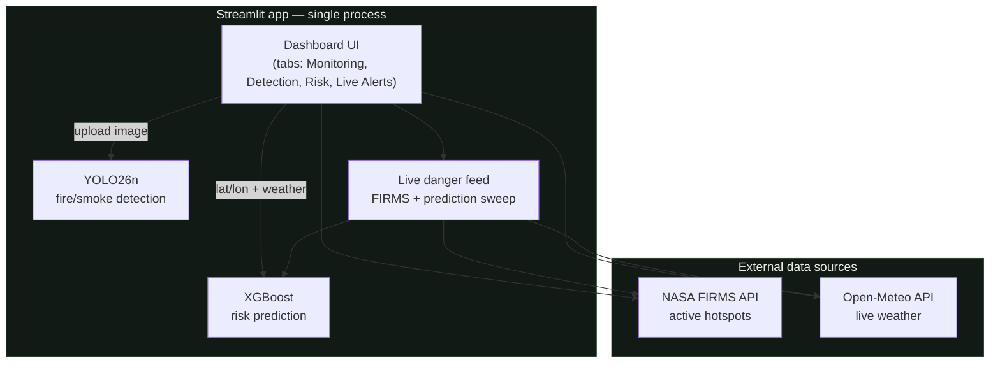

# FireGuard AI

> **Neural Storm 2026 — Green Planet track** (Sustainability & Environmental
> Intelligence). Self-defined problem statement within the track, as
> permitted by the competition rules.

AI dashboard for early wildfire detection, risk prediction, and real-time
alerts for wildfire-prone regions in Indonesia.

## Team
**Tim FireGuard**
- Mus

## Table of Contents
- [Problem & Solution](#problem--solution)
- [Architecture](#architecture)
- [Tech Stack](#tech-stack)
- [Repo Structure](#repo-structure)
- [Setup & Installation](#setup--installation)
- [Running the Project Locally](#running-the-project-locally)
- [Datasets](#datasets)
- [Model Performance](#model-performance)
- [Screenshot / Demo](#screenshot--demo)
- [Deployment](#deployment)
- [AI Tools Disclosure](#ai-tools-disclosure)
- [License](#license)

## Problem & Solution
Wildfires are hard to detect early and predict, so mitigation response is
often too late. FireGuard AI combines four capabilities into one Streamlit
app:

1. **Early detection** — upload an image, a YOLO26 model (ready-made checkpoint, see [Model Performance](#model-performance)) detects smoke/fire with a confidence score.
2. **Risk prediction** — pick a location, pull live weather, and get a fire-risk score (Low/Medium/High) from a trained XGBoost model.
3. **Real-time monitoring** — a map of active hotspots from NASA FIRMS.
4. **Live danger feed** — automatically combines fresh NASA FIRMS hotspots
   with a risk-prediction sweep across known fire-prone regions (Kalimantan,
   Sumatra), refreshed whenever the app loads — no manual lookup required
   for either signal.

The on-screen risk prediction and detection tabs are for an on-demand,
single-location check; the live danger feed is what turns "the user can
check one point manually" into "the app watches fire-prone regions on its
own and surfaces a warning the moment you open it."

(Note: this runs as a single Streamlit app, not a push-notification service —
there's no background server to wake a phone while the app is closed. See
[`lib/danger_feed.py`](./lib/danger_feed.py) for the automated sweep logic,
and the Deployment section for what a true push-alert version would need.)

## Architecture



Everything runs in one Python process: no separate frontend/backend split,
no proxy layer, no database. The two trained models
(`backend/models/risk_model.joblib`, `backend/models/wildfire-smoke.pt`) are
loaded once per session (`st.cache_resource`) and called in-process. This
replaced an earlier Next.js + FastAPI + Vercel architecture — removed to
cut deployment friction (serverless function size limits, multi-service
coordination) in favor of a single deployable unit, as Streamlit Cloud /
HF Spaces are built for.

## Tech Stack
- **App**: Streamlit, Folium/streamlit-folium (map)
- **Detection**: YOLO26 (Ultralytics)
- **Risk prediction**: XGBoost / scikit-learn
- **Data sources**: NASA FIRMS API, Open-Meteo API

## Repo Structure
```
app.py                      Streamlit entry point (all 4 tabs)
lib/                        App-level helpers
  weather.py                 Open-Meteo client
  firms.py                   NASA FIRMS client + sample-data fallback
  monitored_locations.py     Fire-prone regions checked automatically
  risk_model.py              Loads risk_model.joblib, predicts risk
  detect_model.py            Loads wildfire-smoke.pt, runs YOLO inference
  danger_feed.py             Combines FIRMS + prediction sweep (live alerts)
  style.py                   Custom CSS/theme
.streamlit/
  config.toml                Theme (dark + orange accent), minimal toolbar
requirements.txt             Deployment deps (Streamlit Cloud / HF Spaces)

backend/                    ML pipeline (training, not runtime-required)
  routers/                   (legacy) FastAPI endpoints, kept for reference
  ml/
    detect/                  YOLO detection pipeline (train, evaluate, dataset config)
    risk/                    Risk model pipeline (preprocess, train) + methodology
  scripts/                   Dataset download scripts, dev env setup
  tests/                     Unit & integration tests
  models/                    Trained model weights (committed — see Model Performance)
  data/
    raw/                     Downloaded datasets (gitignored, ~3.6GB)
    processed/               Training artifacts: metrics, confusion matrices (tracked)

docs/                        Screenshot(s) used in this README
LICENSE                      MIT license
```

## Setup & Installation
```bash
python3 -m venv venv
source venv/bin/activate
pip install -r requirements.txt
streamlit run app.py
```
The two model files in `backend/models/` are committed to this repo, so the
app works immediately after `pip install` — no separate download/training
step required (see [Model Performance](#model-performance) for what they are).

Optional: for real NASA FIRMS hotspot data (instead of the built-in sample
points), create `.streamlit/secrets.toml`:
```toml
NASA_FIRMS_MAP_KEY = "your-free-key-from-firms.modaps.eosdis.nasa.gov"
```

## Running the Project Locally
```bash
streamlit run app.py
```
Open `http://localhost:8501` — all 4 tabs work immediately: Monitoring
(sample hotspots by default), Detection (upload any photo), Risk Prediction
(auto-fetches live weather for 6 pre-set Indonesian regions or a custom
lat/lon), and Live Alerts (the automated FIRMS + risk-sweep feed).

## Datasets
| Module | Dataset | Size | Source |
|---|---|---|---|
| Risk prediction | UCI Algerian Forest Fires Dataset | 244 observations, 2 regions | [UCI #547](https://archive.ics.uci.edu/dataset/547/algerian+forest+fires+dataset) |
| Early detection | FASDD_CV | 95,126 images, YOLO format | [HuggingFace seawsurf/fire_smoke_dataset_fasdd_cv](https://huggingface.co/datasets/seawsurf/fire_smoke_dataset_fasdd_cv) |

The FASDD_CV dataset was downloaded & fully verified during development (see
`backend/ml/detect/README.md`) — it isn't kept in this repo (~3.6GB,
gitignored), but the download script (`backend/scripts/download_detection_dataset.py`)
reproduces it. For the detection model itself, we use a ready-made
checkpoint already trained on the same dataset (not trained from scratch)
— the development laptop has no GPU, and this checkpoint already reaches
good accuracy. See [Model Performance](#model-performance) for full details
+ citation; the in-house training pipeline (`backend/ml/detect/train.py`)
remains available for further fine-tuning.

Full methodology (data cleaning, ablation study, model selection) is in
[`backend/ml/risk/README.md`](./backend/ml/risk/README.md) and
[`backend/ml/detect/README.md`](./backend/ml/detect/README.md).

## Model Performance

### Risk prediction (UCI Algerian Forest Fires Dataset, 20% held-out test)
The production model (`backend/models/risk_model.joblib`) uses XGBoost with
only 4 raw weather features (Temperature, RH, Rain, Ws) — selected from a
comparison of 3 algorithms x 2 feature sets via 5-fold stratified
cross-validation. See `backend/ml/risk/README.md` for the full methodology.

| Feature set | Selected model | CV F1 | Test Accuracy | Test F1 | Test ROC-AUC |
|---|---|---|---|---|---|
| raw (production) | XGBoost | 0.863 | 0.959 | 0.963 | 0.998 |
| full (+ FWI indices) | XGBoost | 0.987 | 1.000 | 1.000 | 1.000 |

Honest note: the test set is only 49 rows (20% of 244), so the confidence
interval on the metrics above is wide — the "1.000" on the "full" feature set
is likely partly due to the small sample size, not a claim of a perfect
model in the real world. Reproduce with: `cd backend && python -m ml.risk.train`.

### Early detection (FASDD_CV)
The production model (`backend/models/wildfire-smoke.pt`) is a ready-made
YOLO26n checkpoint from [seawsurf/fire_yolo](https://huggingface.co/seawsurf/fire_yolo)
(CC BY 4.0), trained on the exact same FASDD_CV dataset we downloaded &
verified. The metrics below are recomputed directly from that model's own
`results.csv` at the `best.pt` checkpoint epoch (epoch 78/100, selected via
early-stopping):

| Metric | Value |
|---|---|
| mAP50 | 0.774 |
| mAP50-95 | 0.527 |
| Precision | 0.783 |
| Recall | 0.674 |

We did not train the detection model from scratch — the development laptop
has no GPU, and training 95k images on CPU isn't realistic within a
hackathon timeline. The in-house training pipeline is still there and has
been smoke-tested (see `backend/ml/detect/README.md` & `train.py`) as an
option for further fine-tuning with Indonesian data in the future.

**Citation (FASDD_CV dataset, still required):**
> Wang, M., Yue, P., Jiang, L., Yu, D., Tuo, T., & Li, J. (2025). An open
> flame and smoke detection dataset for deep learning in remote sensing
> based fire detection. *Geo-spatial Information Science*, 28(2), 511-526.
> https://doi.org/10.1080/10095020.2024.2347922

## Screenshot / Demo


> TODO: add a short demo GIF/video walking through all 4 tabs.

## Deployment
Deploys as a single app to **Streamlit Community Cloud** (free) or
**HuggingFace Spaces** (Streamlit SDK):
1. Push this repo to GitHub (already done).
2. On Streamlit Cloud: New app → point at this repo → main file `app.py`.
3. (Optional) Add `NASA_FIRMS_MAP_KEY` under App settings → Secrets, in the
   same `key = "value"` TOML format as `.streamlit/secrets.toml` above.

> TODO: fill in the live deployment link once deployed.

**On the live danger feed vs. true push notifications:** this app refreshes
its automated checks whenever it's loaded (or every 15 minutes per tab via
`st.cache_data(ttl=900)`), which is honestly a "check on open" model, not a
background push to a closed phone. A true push-notification version would
need a small always-on service (e.g. a scheduled job + Web Push) running
independently of the Streamlit process — out of scope for this submission,
noted here rather than implied.

## AI Tools Disclosure
- This project was built with the help of **Claude Code** for project
  scaffolding, code writing, data cleaning, training pipelines, and
  documentation.
- The detection model (`wildfire-smoke.pt`) is a pre-trained third-party
  checkpoint (not trained by the team) — see credit & citation in the
  Model Performance section and `backend/ml/detect/README.md`.
- The risk prediction model (`risk_model.joblib`) was trained in-house by
  the team using the UCI Algerian Forest Fires dataset — see
  `backend/ml/risk/README.md`.

## License
MIT — see [`LICENSE`](./LICENSE). The third-party dataset and detection
model used by this project are CC BY 4.0 (see citations above) and keep
their own license independent of this repo's code.
